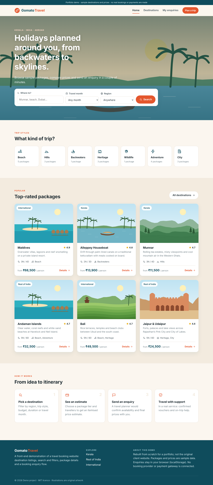
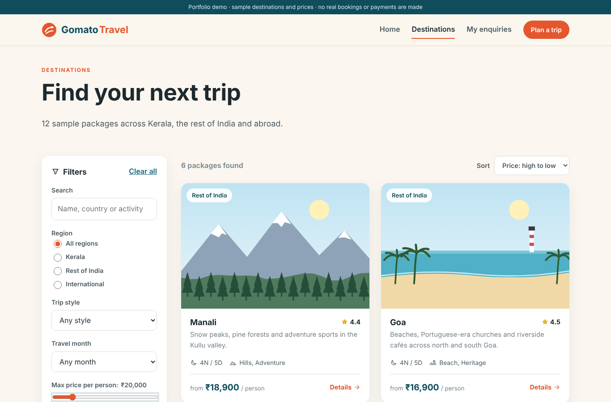
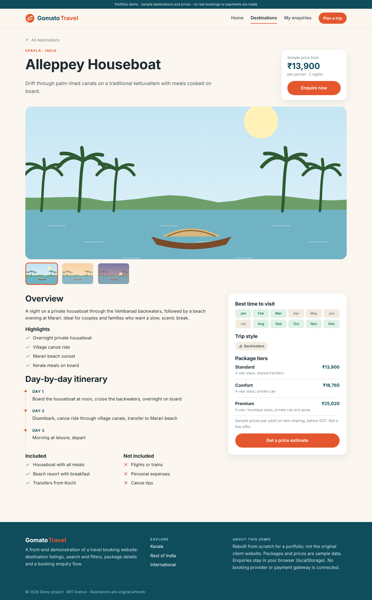
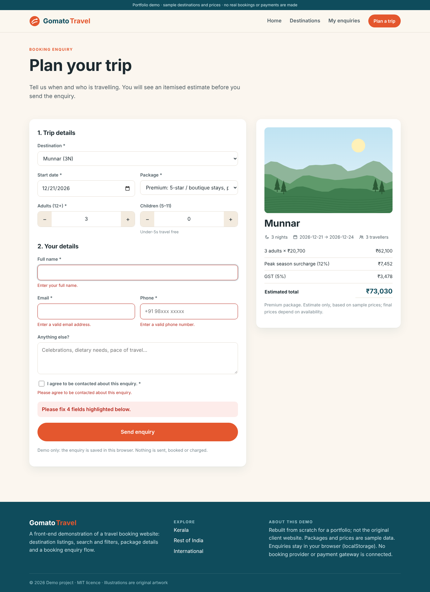
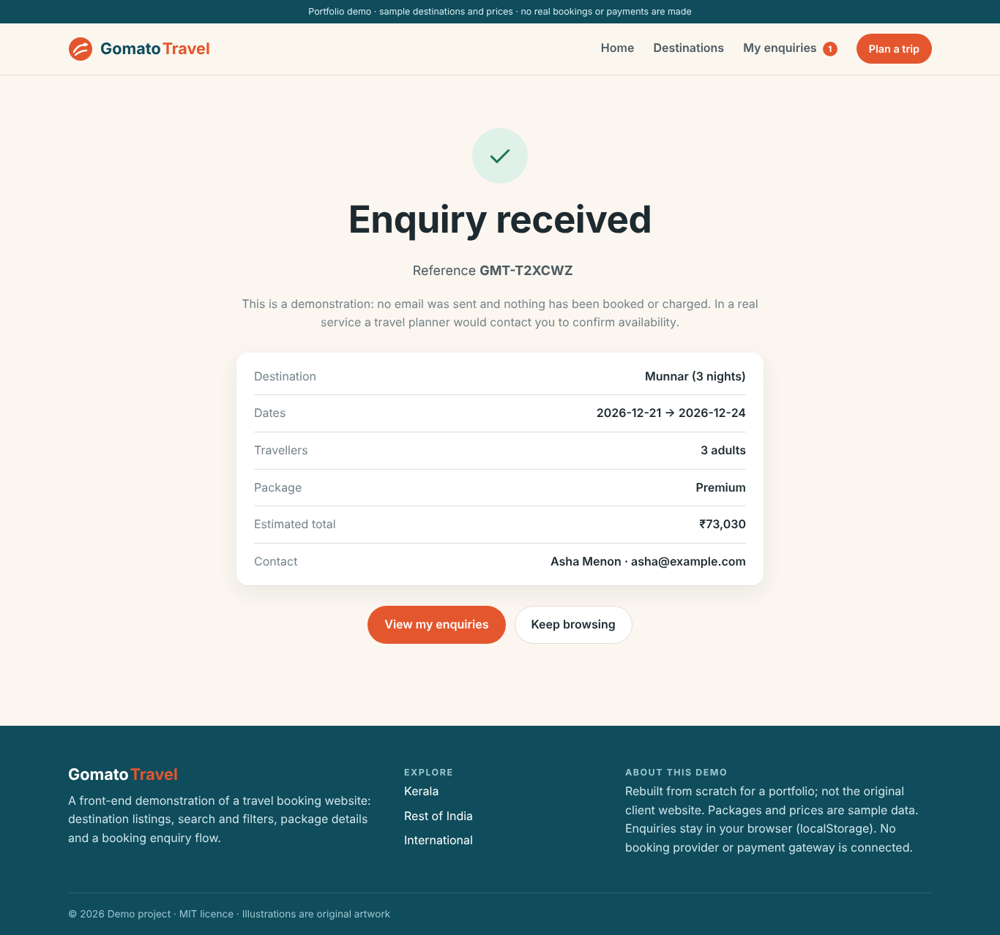
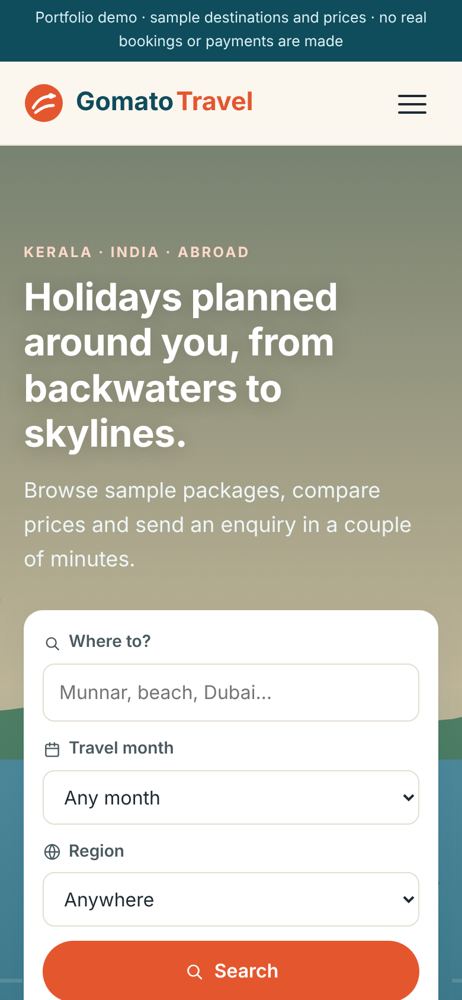
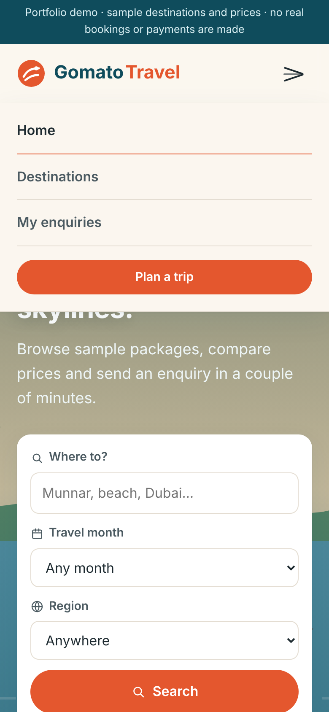

# Gomato Travel – Travel Booking Website (Independent Reconstruction)

A responsive travel booking front end built with **plain HTML, CSS and JavaScript** (no framework). It includes a homepage with search, destination listings with live search and filters, destination detail pages, and a booking enquiry flow with an itemised price estimate.

> **About this repository**
> I originally worked on Gomato Travel as a client website at Elif Consultancy & Services. I no longer have access to the original code, so this is a **from-scratch rebuild** showing the same kind of work. It is **not** the original client site.
> - Destinations are real places, but **every package, itinerary, price and rating is sample data**.
> - **No booking provider, payment gateway or email service is connected.** Enquiries are saved only in your browser (`localStorage`).
> - All images are **original SVG illustrations** generated by [`tools/generate-images.mjs`](tools/generate-images.mjs) (MIT). No stock photos are used.



## Objectives

- Build a responsive, accessible travel website without a framework, with clean, modular JavaScript.
- Implement working search, filtering and sorting with shareable URLs.
- Design a booking enquiry flow with validation and a transparent price breakdown.
- Keep the business logic in pure functions so it can be unit-tested.

## Features

- **Homepage**: hero search (destination keyword, travel month, region), trip-style tiles with live counts, top-rated packages, "how it works".
- **Destination listings**: text search across names, countries and highlights; region, trip style, travel month (best-season data), price slider and trip-length filters; five sort orders; result count; empty state with "clear filters". All filters are kept in the URL (e.g. `#/destinations?region=Kerala&type=Hills`), so views can be bookmarked and shared.
- **Destination details**: three-image gallery, overview, highlights, day-by-day itinerary, inclusions and exclusions, best months to visit, price by package tier, related trips.
- **Booking enquiry**: destination, start date, package tier, adults and children with steppers, and contact details. Field-level validation with accessible error messages. A live estimate shows per-person cost, child rate, single-room supplement, a peak-season surcharge (20 Dec to 5 Jan) and GST. On submission the enquiry gets a reference number (e.g. `GMT-7K3Q9P`) and a confirmation page.
- **My enquiries**: lists enquiries saved in the browser, with a count badge in the header and an option to remove each one.
- **Responsive navigation**: a mobile menu with `aria-expanded` state that closes with Escape or on navigation; a skip link; visible focus styles; reduced-motion support.
- **SVG icon set**: hand-drawn inline icons in [`js/icons.js`](js/icons.js).

## Technology stack

HTML5 · CSS3 (custom properties, Grid, Flexbox) · JavaScript ES modules · Node.js only for the local server and tests · `node:test` · Playwright (`playwright-core`) for browser tests

## Folder structure

```
gomato-travel-booking-website/
├── index.html               # app shell: header, nav, footer
├── css/styles.css           # all styles, mobile-first
├── js/
│   ├── app.js               # hash router, page rendering and event handling
│   ├── logic.js             # pure functions: filter, sort, price estimate, validation
│   ├── data.js              # sample destinations and package tiers
│   └── icons.js             # inline SVG icons
├── images/                  # generated SVG illustrations (3 per destination) + favicon
├── tools/
│   ├── serve.mjs            # zero-dependency static server
│   └── generate-images.mjs  # regenerates the illustrations
├── tests/
│   ├── logic.test.mjs       # 9 unit tests (node:test)
│   └── e2e.mjs              # 10 browser checks; writes docs/screenshots
└── docs/screenshots/
```

## Installation and running

Requirements: Node.js 18+ (only for the local server and tests). The site itself is static.

```bash
git clone https://github.com/<your-username>/gomato-travel-booking-website.git
cd gomato-travel-booking-website
npm start            # serves the site on http://localhost:8080
```

ES modules don't load from `file://`, so use the included server or any static server (for example `python -m http.server`). The site can be deployed as-is to any static host, such as GitHub Pages.

## Testing

```bash
npm test             # unit tests for filtering, sorting, pricing, validation and helpers
npm install          # once, for playwright-core
npm run e2e          # drives Chrome through every page and interaction
```

The browser test needs Chrome or Chromium. Set `CHROME_PATH` if it isn't found automatically, or run `npx playwright install chromium`.

| Suite | Checks | Result |
|---|---|---|
| Unit (`tests/logic.test.mjs`) | 9 | all passing |
| End-to-end (`tests/e2e.mjs`) | 10 (desktop and mobile; also checks for no horizontal scroll and no console errors) | all passing |

## Screenshots

| | |
|---|---|
|  Filtered and sorted listing |  Destination detail |
|  Booking form with validation and estimate |  Enquiry confirmation |
|  Mobile homepage |  Mobile navigation |

## Limitations

- **Front end only.** There is no server-side storage, booking engine, availability check, payment or email. A real deployment would post enquiries to an API or CRM.
- **Sample content.** Prices, ratings, itineraries and inclusions are illustrative; ratings are not customer reviews.
- **Pricing rules** (child rate, single supplement, peak dates, GST) are simplified examples.
- **Enquiries live in `localStorage`**, so they are tied to one browser and can be cleared by the user.
- Hash-based routing keeps hosting simple but is less SEO-friendly than server-rendered pages.

## Licence

MIT, see [LICENSE](LICENSE). The illustrations and icons are original work under the same licence.
